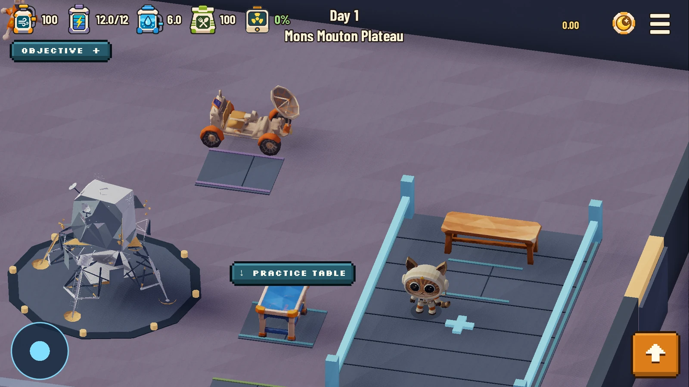
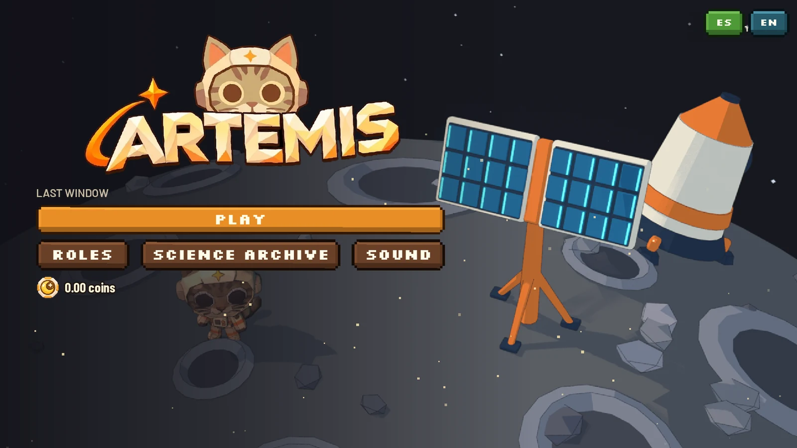
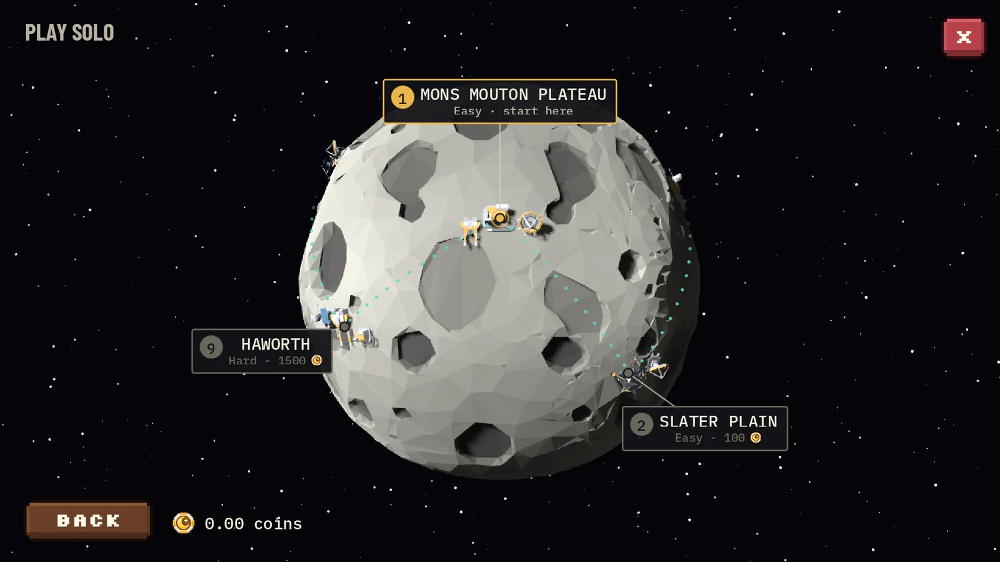
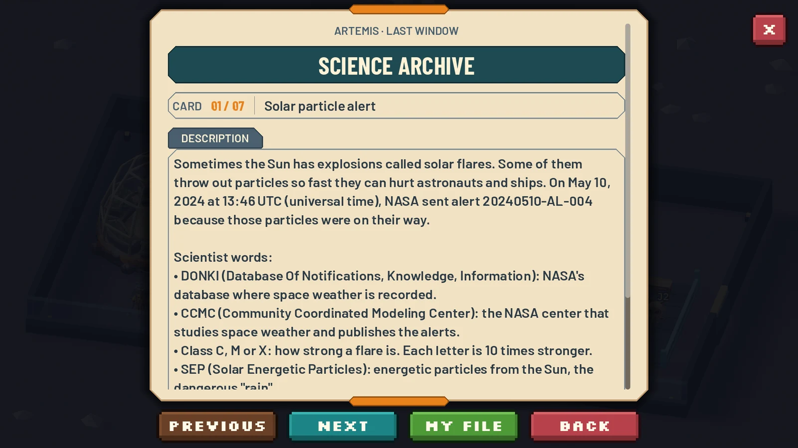
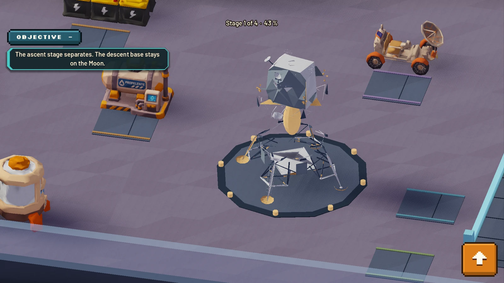

<h1 align="center">ARTEMIS · Última ventana</h1>

Entrenador de misión lunar en 3D para astronautas junior

  
  
  
  

  

Una tripulación de cadetes aterriza cerca del polo sur lunar. Tu misión es aprender a operar el puesto, mantener las reservas de la base y preparar un regreso seguro a la Tierra. Cada amanecer guarda el progreso y otorga monedas para desbloquear nuevas bases y roles.

Proyecto educativo para el reto **Junior Astronaut Mission Trainer** de [NASA Space Apps Challenge](https://www.spaceappschallenge.org/2026/challenges/junior-astronaut-mission-trainer/).

## Jugar en Android

1. Abre la [release v1.0.0](https://github.com/LuisNafate/artemis-apagon-lunar/releases/tag/v1.0.0) y descarga **Artemis-Ultima-Ventana-v1.0.0.apk**.
2. Abre el archivo en un dispositivo **Android 7.0 o posterior, ARM64**. Android puede pedirte que autorices la instalación desde la aplicación que abrió el archivo.
3. Elige **Jugar → Mons Mouton Plateau**. En el puesto, ve a la **Mesa de práctica** y completa la primera tarea.

| Control | Acción |
| --- | --- |
| Joystick o toque sobre el suelo | Mover al piloto |
| Rótulo del objetivo | Ir a la estación indicada |
| Botón de la estación | Tomar, producir o entregar |
| Botón de salto | Saltar |
| Menú → Guardar y salir | Guardar y volver al selector |

## La misión

- **Sostén la base.** Extrae y refina hielo, cuida los cultivos y vigila aire, agua, batería y radiación.
- **Responde al entorno.** Anticipa la noche lunar y entra al refugio cuando llegue una alerta solar.
- **Prepara el regreso.** Carga tres lotes de propelente y dos raciones, confirma el plan por radio y aborda la nave.
- **Explora nueve bases.** Usa las monedas para desbloquear destinos y roles. El progreso se guarda por base.

## Galería

| Portada | Selector de bases |
| :---: | :---: |
|  |  |
| **Archivo científico** | **Despegue lunar** |
|  |  |

[Ver las 13 capturas de la interfaz en inglés](docs/screenshots/README.md).

## Ciencia y créditos

El [archivo científico](context_core/science_catalog.md) reúne datos de DONKI sobre actividad solar, mediciones de radiación de Artemis I y referencias de la misión LRO. La campaña usa estos materiales como contexto y ajusta las escalas de tiempo, consumo y exposición para el juego.

[Fuentes y atribuciones](THIRD_PARTY_NOTICES.md) · [Reglas de la campaña](context_core/campana_lunar_vigente.md). Proyecto independiente de NASA.

## Abrir el proyecto

- Importa `project.godot` en **Godot 4.7.2** y pulsa **F5**. En escritorio puedes usar el ratón para accionar los controles de pantalla.
- Para comprobar el código desde PowerShell, instala `gdtoolkit` y ejecuta `./tests/verify.ps1`. Si Godot no está en el PATH, pasa su ejecutable con `-Godot`.
- Para exportar Android, instala las plantillas de la misma versión y configura Java, Android SDK y la firma en Godot. [Documentación de exportación](https://docs.godotengine.org/en/4.7/tutorials/export/exporting_for_android.html).

[Código y estructura del motor](context_core/architecture_tree.md) · [Auditoría de la versión](docs/release-verification.md). El repositorio publica el código fuente del proyecto. Los materiales de terceros conservan sus propios términos.
