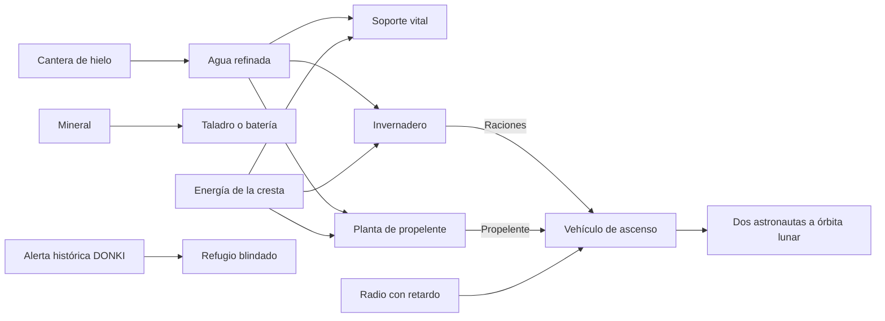

# Artemis · Última ventana

## Demo · Estación Cresta

Una estación lunar ficticia en el entorno de Shackleton. Dos astronautas comparten una pantalla 3D y deben despegar juntos hacia órbita lunar. La partida apunta a **6–8 minutos**. Ambos pueden extraer, construir, cocinar, reparar y transportar. La cámara fija a tres cuartos mantiene visibles las rutas y el refugio. La cresta iluminada y las sombras del cráter se inspiran en observaciones lunares de NASA. [Shackleton](https://science.nasa.gov/resource/shackleton-craters-illuminated-rim-shadowed-interior/)

| Zona de la estación | Qué se hace allí | Decisión |
| --- | --- | --- |
| Hábitat y refugio central | Recuperar aire con soporte vital, comer y resguardarse | Volver ahora cuesta un viaje. Seguir fuera acumula exposición |
| Cresta solar | Distribuir batería entre soporte, cultivo y planta de propelente | Proteger las reservas o adelantar una tanda para el cohete |
| Cantera en sombra | Extraer mineral e hielo y cargar una caja por viaje | Atajo expuesto o pasarela larga con acceso al refugio |
| Taller e invernadero | Refinar hielo, cultivar y usar mineral para instalar una mejora | Mejorar el taladro para viajes futuros o ampliar la batería para el apagón |
| Plataforma y radio | Cargar propelente y raciones, enviar la lista de vuelo y embarcar | Preparar el lanzamiento mientras el otro astronauta sostiene la base |

### Lo que se juega

1. **Primera caja.** El tutorial ocurre en el mapa. Dos astronautas recogen, entregan a su compañero y depositan una muestra. La interfaz muestra una acción por jugador y el reloj empieza al confirmar el turno. Meta de observación de 45 s hasta el primer intercambio.
2. **Hacer crecer la estación.** Extraer hielo o mineral, entregar cajas y poner en marcha las estaciones genera nuevas rutas y prioridades. Con 2 de mineral se construye una mejora de taladro que reduce la perforación de 6 a 4 s. Por el mismo coste se instala una batería auxiliar de 4 unidades. Cada mejora se compra una vez y las dos pueden coexistir.
3. **Sostener a la tripulación.** El agua refinada se comparte entre soporte vital, riego y planta de propelente. Las cosechas entregan raciones que se pueden comer o cargar en la nave. El hábitat parte con una reserva y una bandeja de cultivo lista para regar. La batería alimenta primero soporte vital y admite seleccionar cultivo o planta como segunda prioridad. Las cargas sin energía suficiente se pausan.
4. **Cambiar de plan.** Una alerta de partículas solares avisa 20 s antes y marca el refugio físico. Si falta carga, el refugio conserva su blindaje y el soporte vital deja de reponer aire. Más tarde llega un corte de luz programado por sombra de la cresta. El alcance de ambos eventos se ve en el mapa. Se puede seguir trabajando dentro con reservas o esperar y recuperar el tiempo con una mejora.
5. **Despegar juntos.** El ascenso requiere tres lotes de propelente, dos raciones a bordo, confirmación por radio y ambos astronautas físicamente sentados. Tierra responde después de unos 2,56 s simulados en tiempo real. Se puede seguir jugando mientras llega la respuesta. Una vez armada la secuencia, el conteo se cancela si falta un astronauta o la ventana ya no es segura. El informe identifica una decisión, su consecuencia y la referencia científica.

La partida termina al despegar, al agotarse la ventana o cuando un astronauta agota el aire o alcanza el límite didáctico de exposición. Las partidas siguientes permiten probar otra inversión o ruta. Una variante de práctica protege el reloj y conserva las mismas acciones.

### Economía inicial para probar

Son valores provisionales en unidades de juego. Un hielo produce una unidad de agua al refinarse. Un ciclo de cultivo consume agua y energía y entrega dos raciones. Un lote de propelente consume dos de agua y energía. El fraccionamiento del agua y el acondicionamiento de hidrógeno y oxígeno se representan en una estación con un proceso único, separado del agua potable y del oxígeno de soporte vital. Los ritmos, rendimientos, reservas, segundos de aviso y umbrales tienen que ajustarse con pruebas de dos personas. El apagón debe recortar opciones sin cerrar la única ruta o volver irrecuperable una jugada con antelación razonable.

### Controles y lectura

Jugador 1 usa WASD, E para actuar y Q para soltar o entregar. Jugador 2 usa flechas, Enter para actuar y Shift derecho para soltar o entregar. Escape pausa la simulación de los dos. Los visores, etiquetas y marcas de jugador usan forma y color, y la alerta combina icono, texto y sonido. El HUD presenta aire de ambos, batería y los pasos que faltan para el lanzamiento. Agua, exposición y radio aparecen junto a su estación o cuando requieren atención. La compatibilidad con mandos se comprueba después de validar los dos bancos de teclado.

## Niveles candidatos

| Orden | Estación o ubicación | Qué cambia en la partida |
| --- | --- | --- |
| Demo | **Estación Cresta**, instalación ficticia inspirada en Shackleton | Aprendes logística, energía y refugio en un mapa compacto. La primera partida termina en un despegue |
| 2 | **Puesto Nobile**, instalación ficticia inspirada en la zona estudiada para VIPER | Dos rutas de prospección, terreno que oculta la señal con Tierra, y trabajo local mientras el relé recupera contacto |
| 3 | **Estación Taurus-Littrow**, puesto ficticio en la región histórica de Apollo 17 | Transportas sondas y muestras entre un puesto y un circuito científico inspirado en ALSEP. La nave de ascenso se inspira en Challenger |

Nobile y Taurus-Littrow son candidatos para una expansión. La instalación científica ALSEP fue real y se presenta como referencia histórica. Los puestos habitables del juego, sus mapas y su economía son ficticios. [Operaciones lunares VIPER](https://science.nasa.gov/mission/viper/lunar-operations/) · [Apollo 17](https://www.nasa.gov/missions/apollo/apollo-17-mission-details/)

## Grafo de la demo

> Cada sistema enlaza una exigencia del reto con una decisión visible. El grafo detallado vive en [project_graph.json](project_graph.json).

## Prueba de aceptación

- Una pareja nueva intercambia su primera carga sin intervención externa. Después identifica qué quiere hacer, qué le falta y dónde conseguirlo.
- Dos estrategias completan el mismo escenario y cada una cambia el recorrido o presupuesto de manera observable. Una prioriza taladro y otra batería. Se repite con el orden de jugadores invertido.
- La ruta de refugio sigue disponible con la planta funcionando o la cresta en sombra. Tras un aviso, ambos pueden alcanzarla desde los extremos abiertos del mapa.
- La tripulación puede rehacer un plan al detectar un desvío temprano de agua o energía. Una receta, entrega o asiento nunca se acredita dos veces. Reiniciar libera reservas de cajas, estados y mensajes pendientes.
- La misión reproduce de principio a fin con red deshabilitada. Se revisan pérdida, pausa, embarque simultáneo, cancelación de cuenta y victoria.
- En el informe, ambos jugadores pueden explicar qué decisión afectó a la supervivencia y qué referencia científica observaron. El interés por repetir se comprueba viendo si eligen otra estrategia y vuelven a jugar.

El reparto de tareas con objetos físicos toma como referencia Overcooked 2. El circuito recoger, transportar, fabricar y mejorar herramientas toma como referencia Unrailed!. [Overcooked 2](https://www.team17.com/games/overcooked-2) · [Unrailed!](https://store.steampowered.com/app/1016920/Unrailed/)

## Ajustes de la versión jugable

La demo usa cámara ortográfica a tres cuartos y movimiento en un plano. Hay un selector de un jugador o dos locales. En individual, Tab alterna el astronauta y el reloj pasa de 7:00 a 8:30. El turno de práctica dura 10:00 y reduce la exposición. F1 abre el archivo científico y congela la simulación. Mayús derecha y la tecla de barra son equivalentes para pasar la carga de J2.

La sombra pausa la respuesta de radio y la producción al agotarse la reserva. Dos avisos programados permiten practicar el refugio. Los tiempos definitivos para esta versión se guardan en state_registry.json. Nobile y Taurus-Littrow siguen como propuestas de nivel.

## Selección de bases lunares

Cresta, Nobile y Taurus-Littrow ahora entran por el mismo selector y representan tres dificultades. Cresta enseña energía y refugio, Nobile añade interrupciones de radio y Taurus-Littrow añade averías solares durante el día. Cada base conserva las estaciones y las señales comunes, tiene su propio terreno y abre su primera ventana en un amanecer distinto. En el amanecer pueden llegar suministros de agua y comida. Los días y las noches duran minutos en la simulación. [NASA · iluminación del polo sur](https://science.nasa.gov/resource/illumination-map-of-the-moons-south-pole/)
