# Artemis · Screenshot gallery

Screenshots from the English interface. Role names printed on the card artwork appear in Spanish.

## Opening cinematic

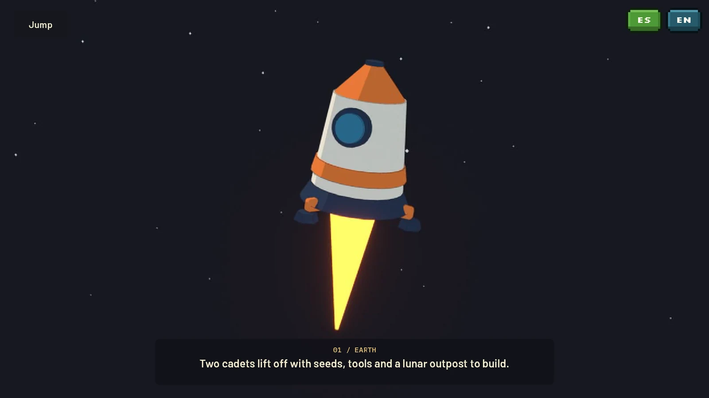

## Main menu

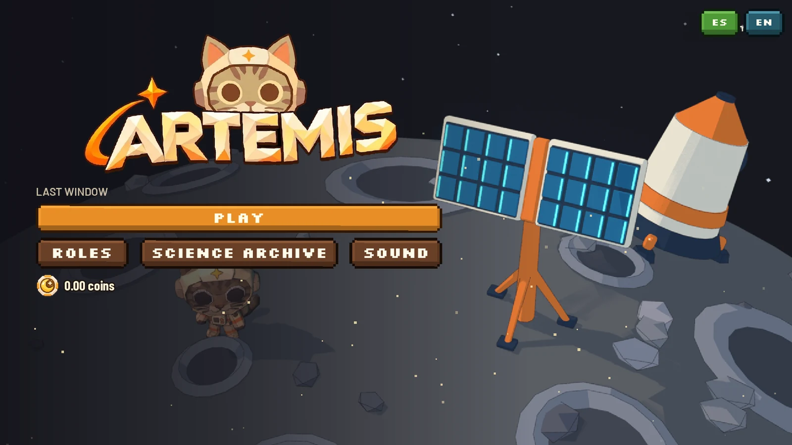

## Lunar base selection

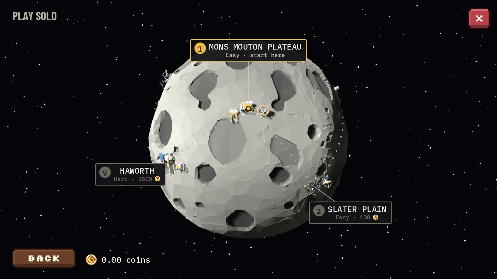

## Crew roles

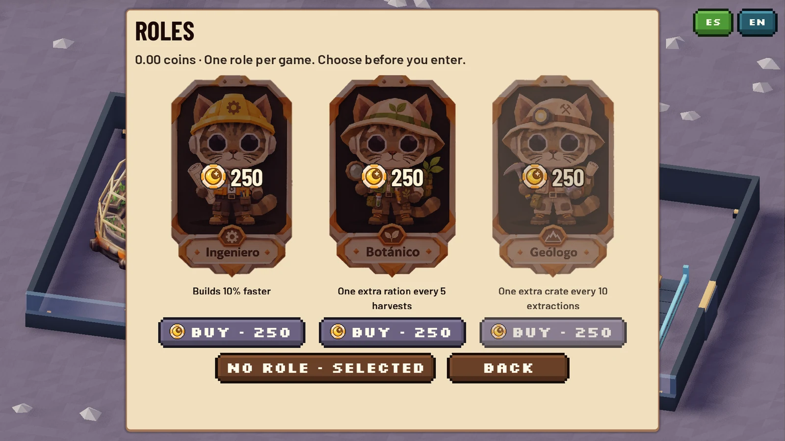

## Science archive

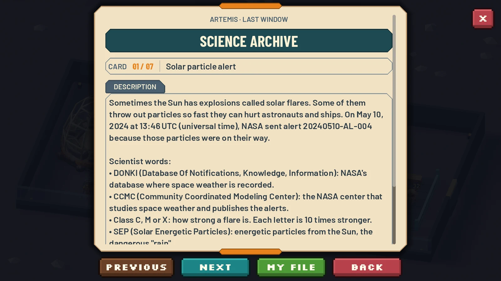

## Scientific dossier

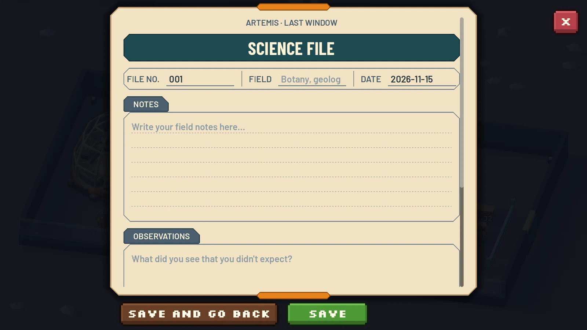

## Gameplay HUD

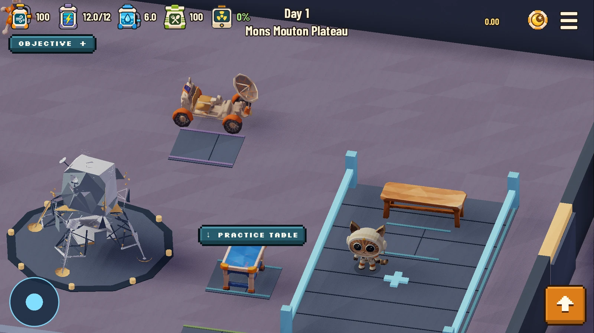

## Training tutorial

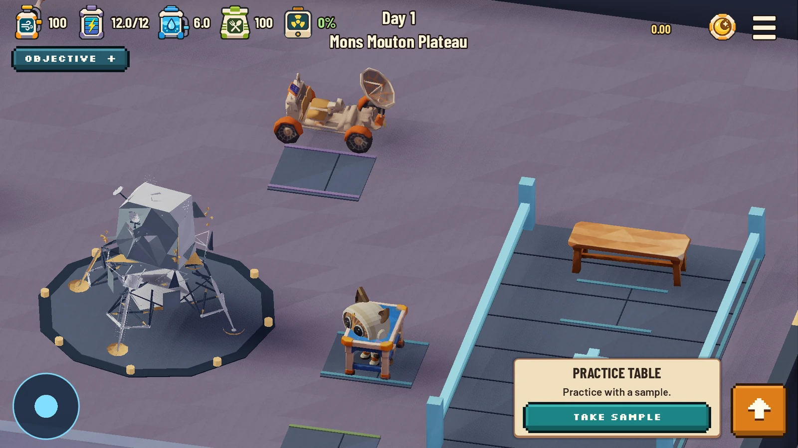

## Solar storm alert

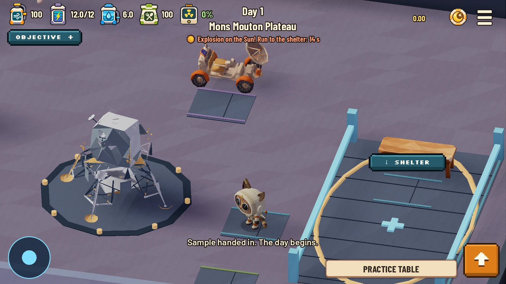

## Propellant production

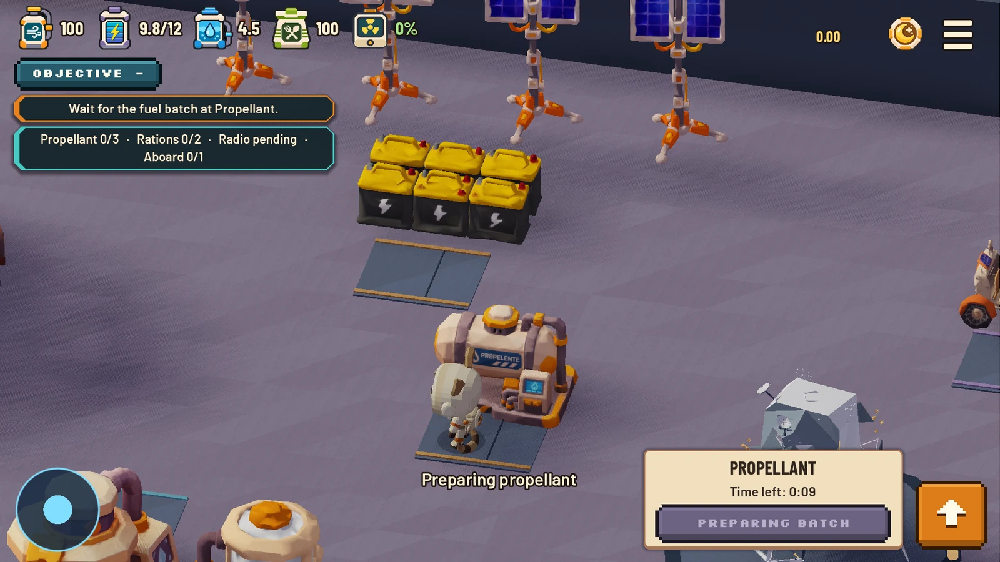

## Pause and options

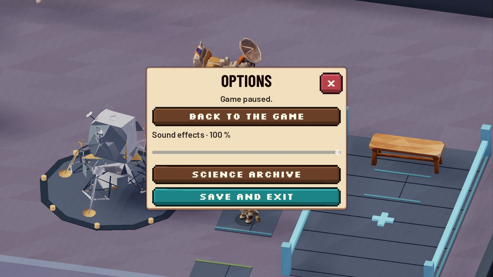

## Lunar liftoff

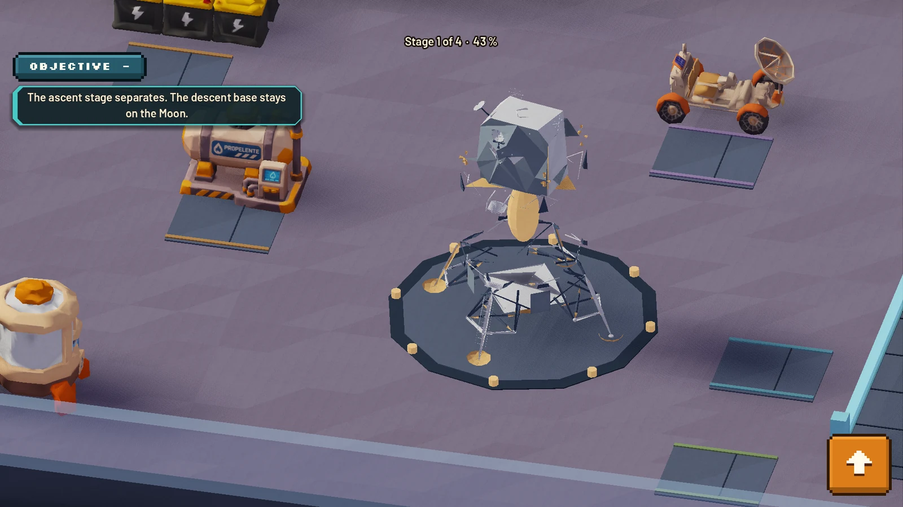

## Return to Earth report

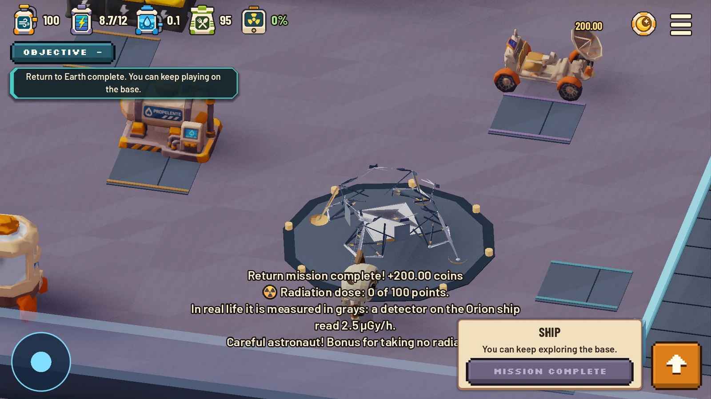
